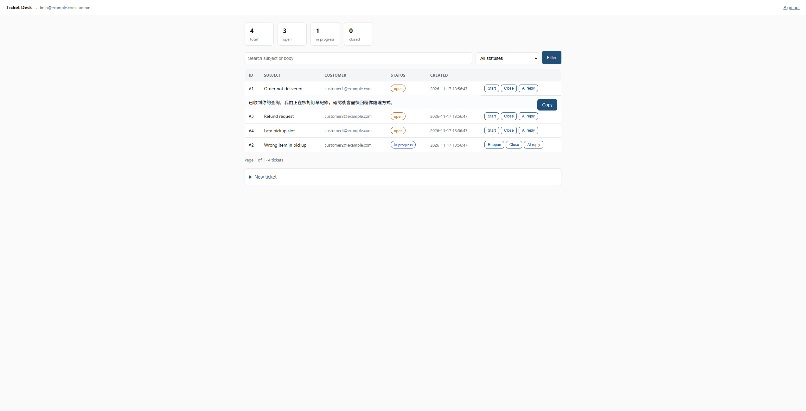

# Ticket Desk — PHP + MySQL support queue


A small but complete internal tool: ticket list with filtering and pagination, a status
state machine enforced on the server, an audit trail, and JSON endpoints the browser uses
for no-reload status updates. Plain PHP 8.3 + PDO + MySQL, no framework, no build step.


## What it does

- **Session login** with `password_hash` / `password_verify`, `session_regenerate_id()` on
  login, and a CSRF token on every state-changing request (form field `_csrf` or header
  `X-CSRF-Token`).
- **Ticket queue** — filter by status, search subject/body, paginate (page size whitelisted
  to 10/20/50, page clamped to the last real page).
- **Status state machine** — `open → in_progress → closed`, `closed → open`, everything else
  rejected with `409`. The UI only renders the buttons the state machine allows, so a
  stale page cannot offer an impossible action.
- **Audit trail** — every accepted transition writes `(actor, ticket, from, to)`, so
  "who closed this and when" is answerable.
- **AI reply drafts** (optional) — one button per ticket posts to
  `POST /api/tickets/{id}/suggest`, which forwards the ticket text to an HTTP RAG service and
  returns a draft with a copy button. No service configured, no problem: the endpoint answers
  `503` and the row shows the reason instead of a blank draft.
- **JSON API** used by the page itself: status updates and stat counters refresh without a
  reload (vanilla `fetch`, no jQuery, no bundler).

```
GET  /api/tickets?status=&q=&page=&per_page=      list + counts
GET  /api/tickets/{id}                            detail + audit + allowed next states
POST /api/tickets/{id}/status  {"status":"..."}    transition (CSRF required)
GET  /api/stats                                   counters for the four cards
POST /api/tickets/{id}/suggest                    reply draft from RAG_BASE_URL (CSRF required)
```

### Wiring the AI reply

`RAG_BASE_URL` points at anything that answers `POST /api/ask` with
`{"question","top_k","generate"}` → `{"answer","refused","reason"}` — the RAG service from my
[hk-law-rag](https://github.com/PugtoX/hk-law-rag) project speaks exactly this contract:

```
RAG_BASE_URL=http://127.0.0.1:8000 php -S 127.0.0.1:8080 -t public server.php
```



Three outcomes are kept distinct because they mean different things to an agent: a draft,
a refusal (`refused: true` — the service declined instead of guessing), and a failure
(unreachable, non-200, malformed body). All three are surfaced; none of them produces a
silently empty draft.

## Run it

### Docker

```bash
docker compose up --build
# app on http://localhost:8080, MySQL on 3307
```

### Without Docker (PHP 8.1+, MySQL 8 / MariaDB 10.4+)

```bash
mysql -u root -p -e "CREATE DATABASE tickets CHARACTER SET utf8mb4;"
mysql -u root -p tickets < db/01_schema.sql
mysql -u root -p tickets < db/02_seed.sql

export DB_HOST=127.0.0.1 DB_PORT=3306 DB_NAME=tickets DB_USER=tickets DB_PASS=tickets
php bin/create_user.php admin@example.com demo1234 admin
php bin/create_user.php agent@example.com demo1234 agent
php -S 127.0.0.1:8080 -t public server.php
```

`-t public` matters: the router returns `false` for real files so the built-in server can
stream CSS/JS from the document root.

## Tests

```
$ vendor/bin/phpunit --no-coverage
OK (11 tests, 31 assertions)

$ php tests/http_check.php http://127.0.0.1:8080
33 passed, 0 failed
```

`tests/TicketStatusTest.php` covers the transition table as a unit. `tests/http_check.php`
drives the running app over HTTP and asserts the things a unit test cannot see: anonymous
redirect, CSRF rejection (`419`), wrong password, login, ticket creation, the four legal
transitions plus the illegal ones (`409`), audit rows, stat totals, invalid input (`422`),
page clamping, and that a `' OR 1=1 --` search string does not widen the result set.

`tests/RagSuggesterTest.php` pins the prompt contents and the payload interpretation
(draft / refusal / service error / blank answer / non-JSON). The HTTP script also exercises the
suggest route against `tests/fake_rag.php`, a stand-in that speaks the same contract, so the
happy path and the refusal path are asserted without a model or a vector store.

CI runs all of it against a real MySQL 8 service container (`.github/workflows/ci.yml`).

## Notes on the decisions

- **The state machine is one class** (`src/TicketStatus.php`), not scattered `if`s in the
  controller, the repo and the template. The template asks it which buttons to draw and the
  repo asks it whether a transition is legal, so the three layers cannot disagree.
- **No ORM.** The SQL is small enough to read, and the pagination query is explicit
  (`LIMIT/OFFSET` with a whitelisted page size, not string interpolation).
- **LIKE wildcards are escaped** before the search term is wrapped in `%…%`, so a user
  searching for `100%` does not become a wildcard.
- **Docker is for other people's machines.** This copy was verified on a Windows box where
  Docker Desktop could not start, using a local PHP 8.3 build plus MariaDB on port 3307 —
  the same code path Docker runs.

## Next step (not built)

The draft is shown, not sent: there is no outbound email yet, so the copy button is the
hand-off. The next honest step is to store the accepted draft on the ticket (who sent it,
when) and only then add a mail transport — a suggestion nobody records is a suggestion
nobody can audit.
